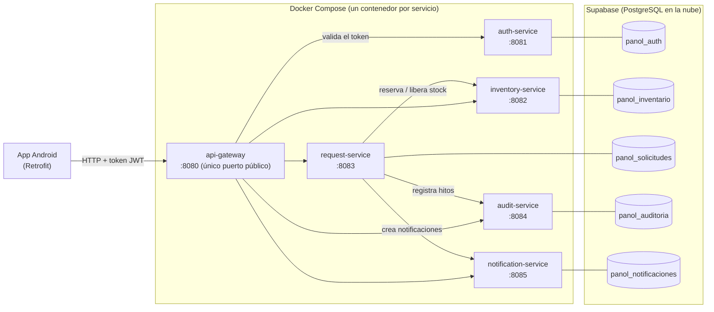
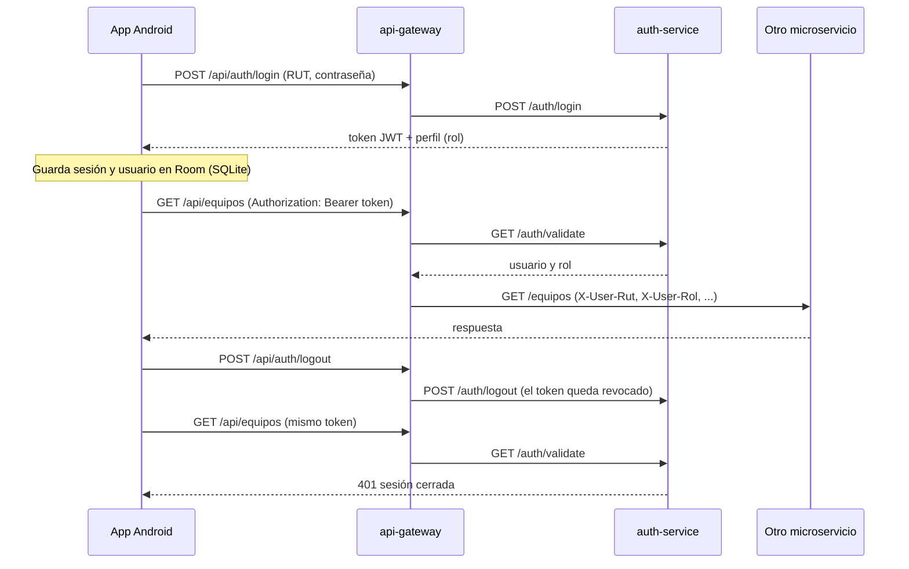
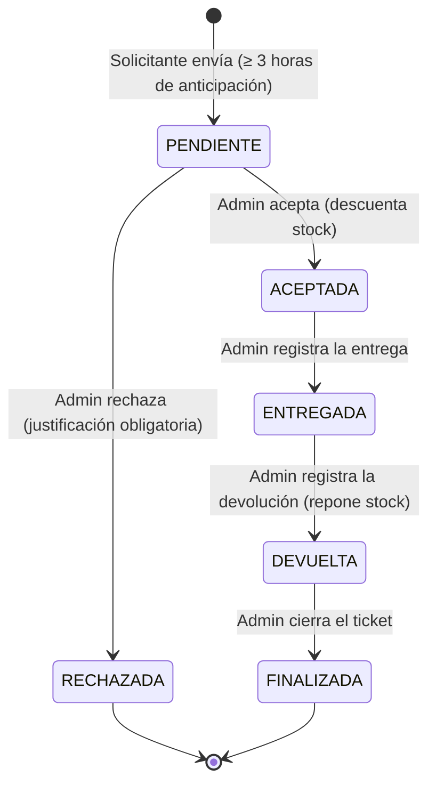

# Diagrama de arquitectura de microservicios

MPAZ Pañol: la app Android consume una sola puerta de entrada (`api-gateway`). Cada microservicio es un proyecto
Spring Boot independiente, con su propio `Dockerfile` y su propio esquema en la base de datos PostgreSQL de Supabase.

## Responsabilidad de cada servicio

| Servicio | Puerto | Responsabilidad | Esquema |
|---|---|---|---|
| `api-gateway` | 8080 | Punto de entrada. Valida el token en cada petición, agrega la identidad del usuario (`X-User-*`) y enruta. Nunca expone `/internal`. | (sin base de datos) |
| `auth-service` | 8081 | Usuarios, perfiles ADMIN / SOLICITANTE, login, logout (tokens revocados) y emisión de JWT. | `panol_auth` |
| `inventory-service` | 8082 | Catálogo, stock total y disponible, estado y ubicación de los equipos; reserva y libera stock con bloqueo para evitar sobreventa. | `panol_inventario` |
| `request-service` | 8083 | Solicitudes de préstamo, regla de 3 horas de anticipación, flujo de estados y justificación de rechazos. | `panol_solicitudes` |
| `audit-service` | 8084 | Bitácora de trazabilidad: Solicitado → Aprobado/Rechazado → Entregado → Devuelto. | `panol_auditoria` |
| `notification-service` | 8085 | Notificaciones internas (simuladas) y recordatorios programados de devolución. | `panol_notificaciones` |

## Autenticación y cierre de sesión

## Flujo de una solicitud de préstamo

Cada cambio de estado deja un registro en `audit-service` y genera una notificación para el solicitante.
