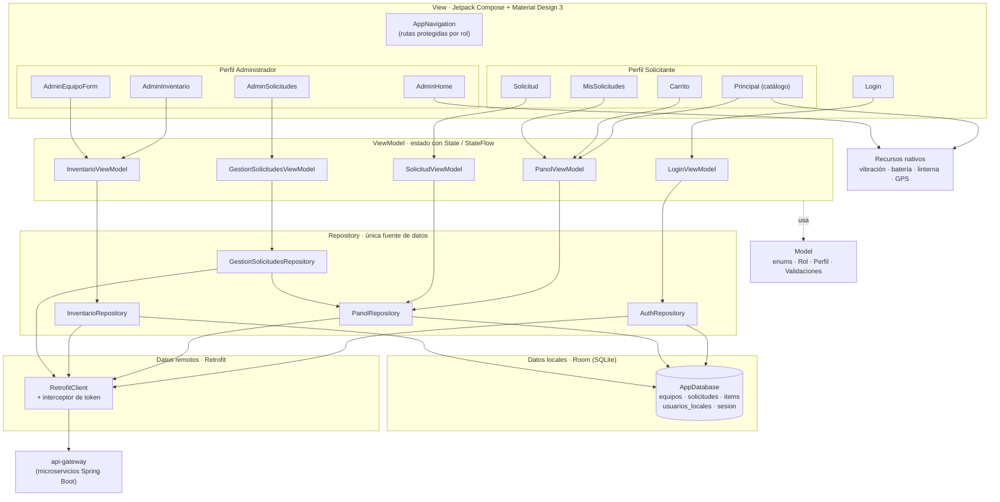
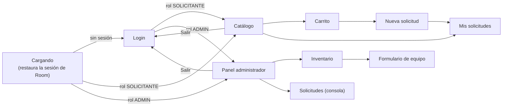

# Diagrama de arquitectura del proyecto Android

MPAZ Pañol usa el patrón **MVVM** con una capa de datos de dos fuentes: la base de datos local (Room / SQLite) y los
microservicios (Retrofit). La interfaz siempre lee desde Room, por lo que la app sigue mostrando datos sin conexión.

## Responsabilidades

| Capa | Paquete | Responsabilidad |
|---|---|---|
| Model | `model/` | Enums (`Categoria`, `EstadoEquipo`, `EstadoSolicitud`, `Rol`), estados de formularios y `Validaciones` (lógica pura, con pruebas unitarias). |
| View | `ui/screen`, `ui/components` | Composables sin lógica de negocio: muestran el estado y notifican eventos al ViewModel. |
| ViewModel | `ui/viewmodel` | Estado de cada pantalla (`mutableStateOf`, `StateFlow`), validación de formularios y llamadas al repositorio. |
| Repository | `data/repository` | Decide de dónde salen los datos: descarga del servidor y actualiza Room; la UI observa Room. |
| Local | `data/local`, `data/database` | Entidades, DAO y base de datos Room. Guarda el catálogo, las solicitudes, el usuario y la sesión. |
| Remote | `data/remote` | Interfaces Retrofit, DTOs, `ApiResult` (éxito, error o sin conexión) y mapeo a entidades. |
| Device | `data/device` | Recursos nativos: vibración y batería (Solicitante); linterna y ubicación GPS (Administrador). |

## Navegación por perfil

Cada pantalla se envuelve en `SoloPara(rol)`: si la sesión activa no tiene el rol requerido, se vuelve al login.
